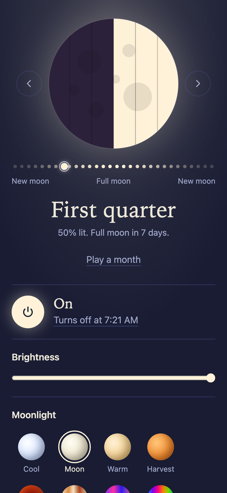
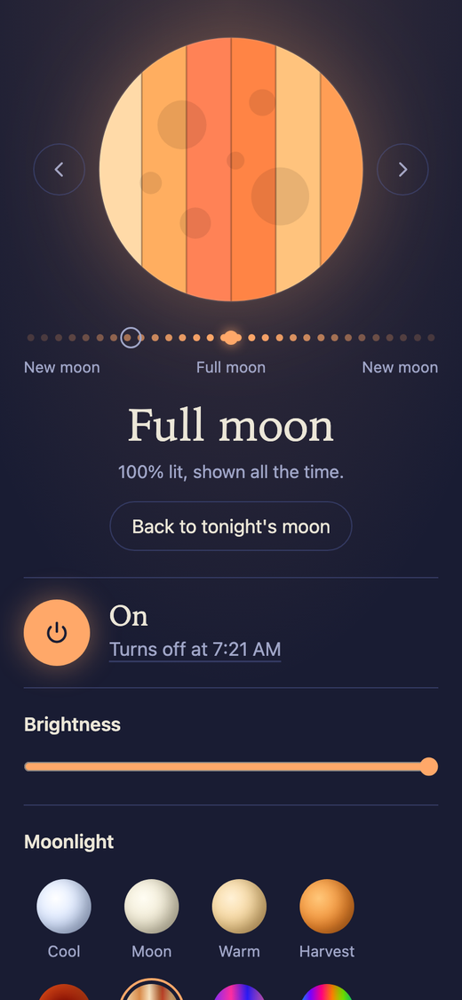
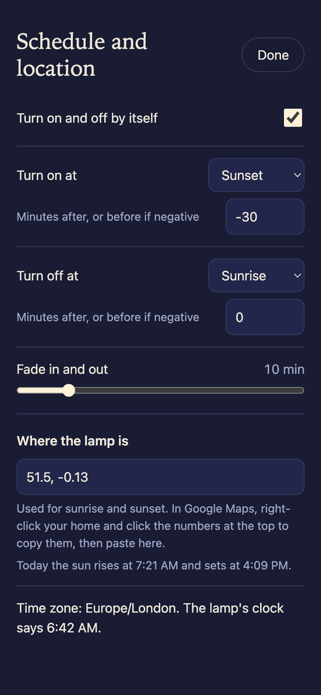
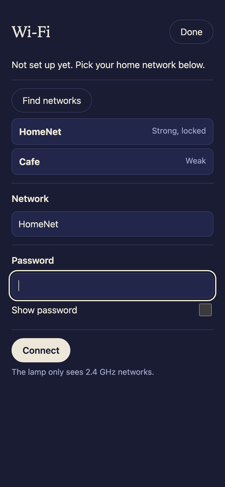
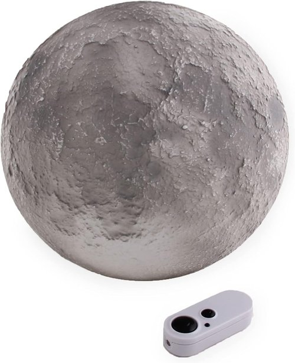
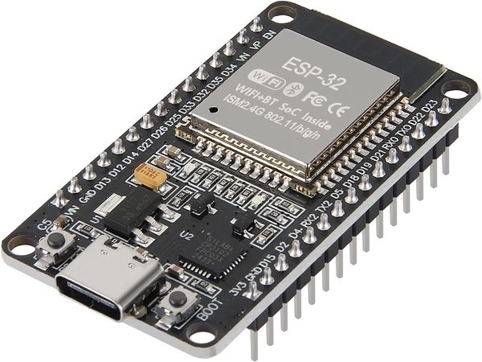

# Moon phase lamp

Firmware that turns an Uncle Milton **Moon in My Room** into a lamp that
shows tonight's real moon phase, with no remote needed.

An ESP32 replaces the toy's original controller. It gets the time from the
internet, works out the phase, and lights the moon's six chambers with an
addressable LED strip. The lamp has its own web page for everything else:
the colour of the moon, a glow on its dark side, themes, a fixed phase if
you'd rather always have a full moon, and turning on and off by itself at
sunset, sunrise or set times.

| Tonight's moon | Themes | Schedule | Wi-Fi setup |
|:---:|:---:|:---:|:---:|
|  |  |  |  |

## Parts

<p>
  
  &nbsp;&nbsp;
  
</p>

- [Uncle Milton Moon in My Room](https://www.amazon.com/dp/B071NM2DZB)
  (its remote isn't needed)
- [ESP32 development board](https://www.amazon.com/dp/B0DF2YJSHN):
  a classic ESP-WROOM-32 DevKit with a CP2102 USB chip and USB-C, like the
  one pictured
- [SK6812 **RGBW** addressable LED strip](https://www.amazon.com/dp/B01N0MA316),
  5 V, 144 LEDs/m, IP30 (about 20 cm is used; natural white on a white PCB
  suits the housing)
- [Three jumper wires](https://www.amazon.com/dp/B0BRTJQGS6), female to
  female, 20 cm (the pack has 40; only three are needed)
- USB cable and a 5 V USB power adapter

The links are to the parts used for this build; similar parts work too.
Photos from the Amazon listings.

## How the toy is built

The moon has six wedge-shaped light chambers separated by baffles. The stock
circuit board is a single strip across the middle with one LED per chamber.
That board is unplugged and left in place as a carrier, and the LED strip is
stuck along the same line.

## Wiring

| Strip wire | ESP32 pin |
|---|---|
| Red (+5 V) | VIN |
| White (ground) | GND |
| Green (data) | D18 |

Connect to the strip's **Din** end. Powering the strip from VIN means the
strip and the board always power up together.

## Installing

The board needs MicroPython 1.20 or later (it has been tested on 1.29).

1. Put MicroPython on the ESP32. The easiest way is
   [Thonny](https://thonny.org): Run → Configure interpreter → MicroPython
   (ESP32) → Install or update MicroPython.
2. Copy every file in the `board` folder to the ESP32. Either:
   - in Thonny, open View → Files, select them all and choose "Upload to /"
     (then close Thonny, which keeps hold of the USB connection), or
   - from a terminal with [mpremote](https://docs.micropython.org/en/latest/reference/mpremote.html)
     (`pip install mpremote`), from this folder:

     ```
     mpremote cp board/main.py board/lamp.py board/net.py board/web.py board/sky.py board/themes.py board/index.html : + reset
     ```
3. The board restarts, and `main.py` runs at every power-on.

To update the lamp later, copy the files again the same way. Your settings
are kept, because they live in a separate `settings.json` on the board.

## Joining your Wi-Fi

The first time it starts, the lamp has no Wi-Fi saved, so it opens its own
network called **MoonLamp-XXXX**, and the whole moon slowly pulses blue.

1. Join MoonLamp-XXXX from your phone or computer. The setup page should pop
   up by itself; if not, open `http://192.168.4.1`.
2. Tap **Find networks**, pick your home network (2.4 GHz only), enter the
   password and tap **Connect**.
3. Once the lamp has joined, the page shows its new address with a Copy
   button and counts down 20 seconds. Then the setup network closes and
   your device goes back to your home Wi-Fi.

From then on the page is at **http://moon.local**, or at the numbered
address the setup page showed (which also works on phones that can't open
`.local` names). In a normal browser tab the setup page moves there by
itself. The small pop-up window that phones and Macs use for setup pages
closes when the Wi-Fi changes instead, so open the address yourself.

If the lamp can't reach your Wi-Fi for a minute (a new router, a changed
password), MoonLamp-XXXX opens again so you can fix it, while the lamp keeps
trying the saved network. The setup network has no password, and the lamp
never shows the saved Wi-Fi password on its page.

## The web page

The page opens on tonight's moon, drawn the way the lamp shows it.

- **See other nights** by dragging the moon, tapping the arrows beside it,
  or tapping the month strip underneath (one dot per night, as bright as
  that night's moon, with tonight circled). The lamp follows. Then choose
  **Keep this phase** to show that phase all the time, or **Back to
  tonight**. **Play a month** runs through a whole month in 30 seconds.
- **Power button**: turns the lamp on or off. With a schedule, this lasts
  until the next scheduled change; turning on while it's scheduled off
  lasts up to 4 hours.
- **Brightness** dims the whole moon, lit side and glow together.
- **Moonlight**: Cool, Moon, Warm and Harvest whites; the themes Blood moon,
  Jupiter, Nebula, Rainbow and Aurora (which can move gently); or Custom to
  set the warmth or mix the white and colour LEDs yourself.
- **Dark side**: no glow, or a glow in Ember, Red, Earthshine, Night blue,
  Violet or your own colour.

Tapping a moonlight or dark side choice shows it off on the lamp for five
seconds: as a full moon for moonlight, as a thin crescent for the dark side.
A ring around the choice counts down, then the lamp goes back to tonight.

The rest is a tap away:

- **Schedule and location**: turn on and off by itself at sunset, sunrise or
  set times (with an offset such as 30 minutes before sunset), with a fade.
  Sunrise and sunset need the lamp's latitude and longitude, pasted in
  once; the time zone comes from the phone or computer you open the page on.
- **Dark side glow**: its strength compared with the lit side, and whether
  to show it only around sunrise and sunset, like earthshine on the real
  moon.
- **Calibrate LEDs**: see the next section.
- **Wi-Fi**: change the network the lamp uses.
- **Lamp**: its name on the network, soft or hard shadow edges, the
  northern or southern hemisphere, the light sweep at switch-on, going back
  to defaults, and restarting.

Changes show on the moon straight away and save themselves a moment later.

## Setting it up for your moon

Open **Calibrate LEDs** on the page:

- **LEDs on the strip**: the number of LEDs on your piece of strip.
- **Light one LED**: step through them to see which chamber each one is in,
  then list each chamber's LEDs, left to right as you face the moon. Leave
  out any LED that sits under a baffle wall and lights two chambers at once.
- **Chamber brightness**: every chamber is given the same total light
  regardless of how many LEDs it has; these sliders correct what is left by
  eye, against a full moon.

### From the USB console

Connect over USB and open the board's console, with Thonny's Shell or with
`mpremote repl`. Press Ctrl-C to stop the program; these helpers still work:

| Command | What it does |
|---|---|
| `walk()` | Lights one LED at a time so you can see which chamber each is in |
| `chamber(0)` | Lights one whole chamber (0 = leftmost, 5 = rightmost) |
| `show(0.5)` | Shows a phase: 0 new, 0.25 first quarter, 0.5 full, 0.75 last |
| `demo()` | Sweeps through a whole month in 30 seconds |
| `startup_sweep()` | Replays the power-on sweep |
| `run()` | Goes back to showing the real phase, with the web page |

Settings can be tried there too, for example `lamp.BRIGHTNESS = 0.5`, then
`show(0.5)`. They apply until the next restart. After changing
`lamp.NUM_LEDS`, `lamp.CHAMBERS` or `lamp.LED0_ON_LEFT`, run `lamp.rebuild()`.

## How it works

- The phase comes from the moon's average cycle length (29.53 days) counted
  from a known new moon. That is typically within about half a day of the
  true phase, which is less than one chamber's worth of difference.
- The shadow edge crosses one chamber per twelfth of the cycle, matching how
  the baffles are cut.
- The clock is set over Wi-Fi at start-up and re-synced twice a day. If Wi-Fi
  drops while it is running, the lamp carries on with its own clock.
- The ESP32 has no time zone data, so the web page works out the time
  zone's daylight-saving changes for the next ten years and sends them to the
  lamp. The lamp works out sunrise and sunset itself, to within a minute or
  two, so the schedule needs no internet once the clock is set.
- Settings are saved in `settings.json` on the board, separate from the
  code. Its values take priority over the defaults at the top of `lamp.py`.

What the moon shows when it isn't showing a phase:

- **The whole moon pulsing blue**: the setup network is open and the lamp
  doesn't know the time yet. Join MoonLamp-XXXX to set it up.
- **A single dim blue LED**: waiting for Wi-Fi or internet time.

A phase you've chosen to keep shows even before the lamp knows the time.

### Files on the board

| File | What it does |
|---|---|
| `main.py` | Starts everything at power-on |
| `lamp.py` | Settings and their defaults, the moon phase, and drawing on the LEDs |
| `net.py` | Wi-Fi, the setup network and internet time |
| `web.py` | The web page and the small API behind it |
| `sky.py` | Local time, sunrise and sunset, and the schedule |
| `themes.py` | Colours for the themes |
| `index.html` | The web page itself |

## Prior art

Earlier versions of this hack replaced the toy's controller with an Arduino
and a real-time clock module:

- [Arduino Controlled Model Moon (Instructables)](https://instructables.com/Arduino-Controlled-Model-Moon-synchronizes-phase-c)
- [Moon light displays realtime phases (Make)](https://makezine.com/?p=61803)
- [Moon phase light modification (Hackaday)](https://hackaday.com/2009/08/19/moon-phase-light-modification)
